# Hotel Management System


My Object Oriented Programming coursework. A Java Swing desktop app for hotel front desk staff to manage customers, rooms, dining tables, bookings, invoices and payments. Data is stored in MariaDB (XAMPP) through JDBC.

**Showcase:** https://cheah20.github.io/HotelManagementSystem/

This was a group coursework project. I did most of the work: the dashboard and login screens, the database and the integration, plus the `Date`, `Time`, `BookingDetail` and exception classes.

<table>
  <tr>
    <td width="50%"></td>
    <td width="50%">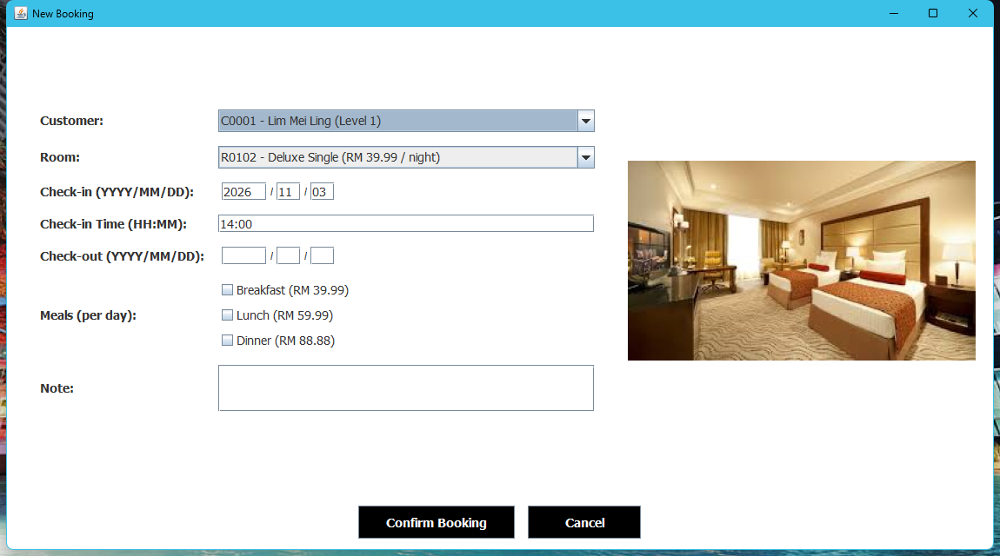</td>
  </tr>
  <tr>
    <td align="center"><b>Opening Screen</b></td>
    <td align="center"><b>New Booking</b></td>
  </tr>
</table>

## Object Oriented Programming

| | |
|---|---|
| Programme | Bachelor of Computer Science (Artificial Intelligence) |
| Faculty | Faculty of Artificial Intelligence and Cyber Security, UTeM |
| Semester | Year 2 Semester 1, 2025/2026 |

## Features

| Menu | What it does |
|---|---|
| Hotel Management | New customer, new room, new booking, new dining table |
| Admin | New staff, new invoice for extra charges, new receipt for walk-in payments |
| View | Staff, customers, rooms, dining tables, bookings, unpaid invoices and receipts |

- Staff log in with their staff ID and password.
- A booking works out the nights, meals and member discount, shows a summary to confirm, then saves the booking, its invoice and marks the room occupied.
- Click a room or table to set it to Available, Occupied or Preparing.
- Click a confirmed booking to check out (room goes to Preparing) or cancel (room is freed and the unpaid invoice is removed).
- Settle Payment turns an invoice into a receipt and adds it to the customer's total paid.
- Customers can be upgraded one level at a time, up to level 5.

## Screens

### Login and Dashboard

<table>
  <tr>
    <td width="50%">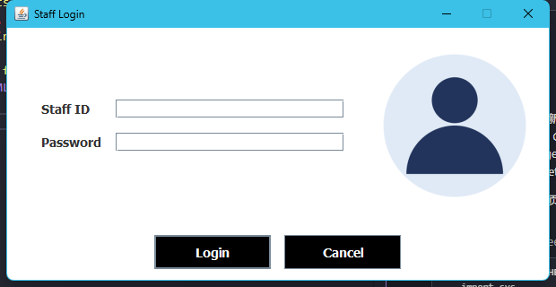</td>
    <td width="50%">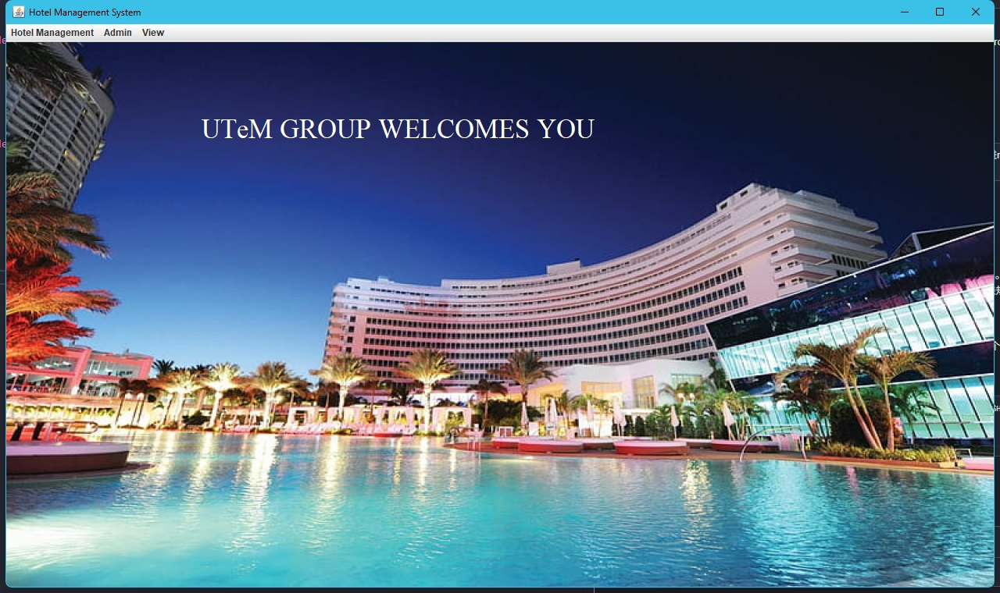</td>
  </tr>
  <tr>
    <td align="center">Staff Login</td>
    <td align="center">Dashboard</td>
  </tr>
</table>

### Hotel Management

<table>
  <tr>
    <td width="50%">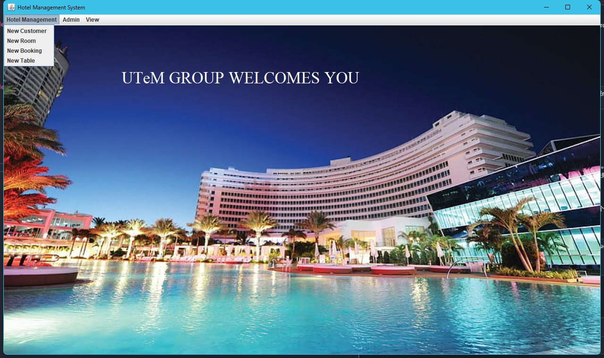</td>
    <td width="50%">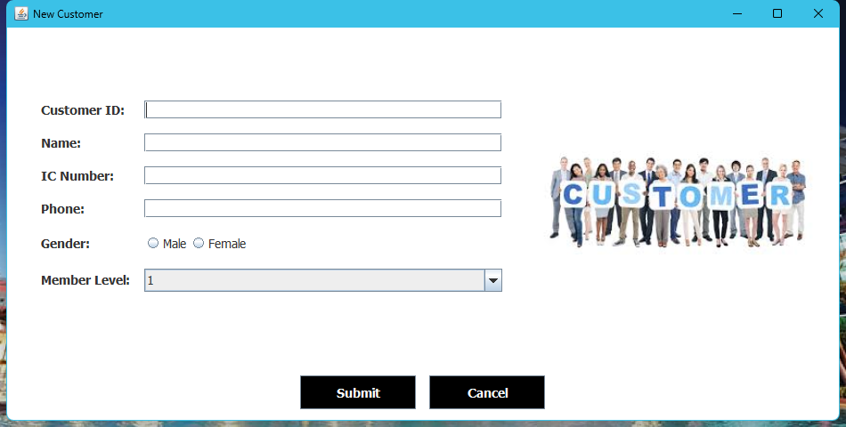</td>
  </tr>
  <tr>
    <td align="center">Hotel Management menu</td>
    <td align="center">New Customer</td>
  </tr>
  <tr>
    <td>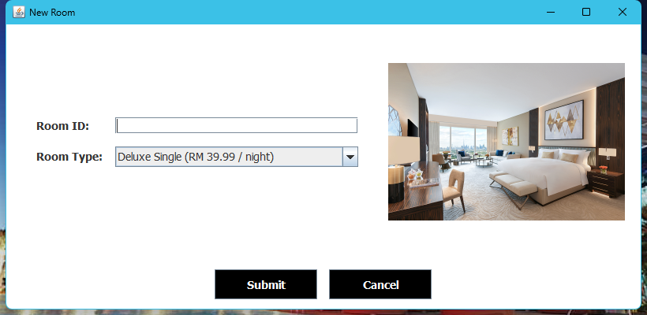</td>
    <td>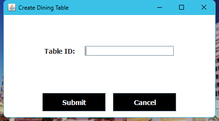</td>
  </tr>
  <tr>
    <td align="center">New Room</td>
    <td align="center">New Dining Table</td>
  </tr>
</table>

### Admin

<table>
  <tr>
    <td width="50%">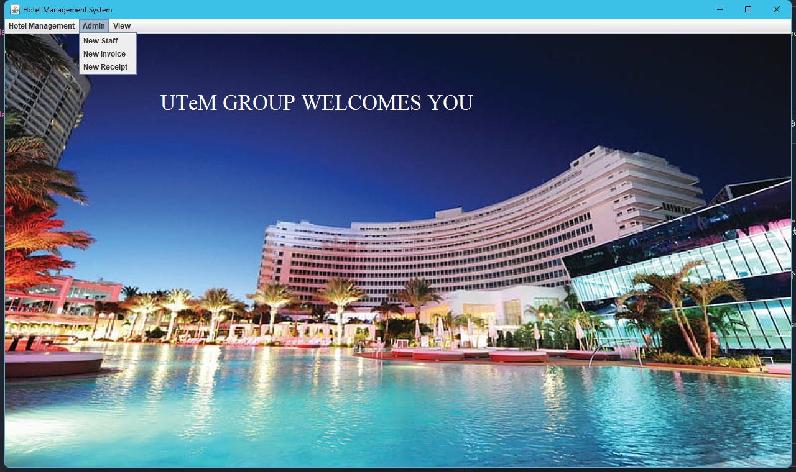</td>
    <td width="50%">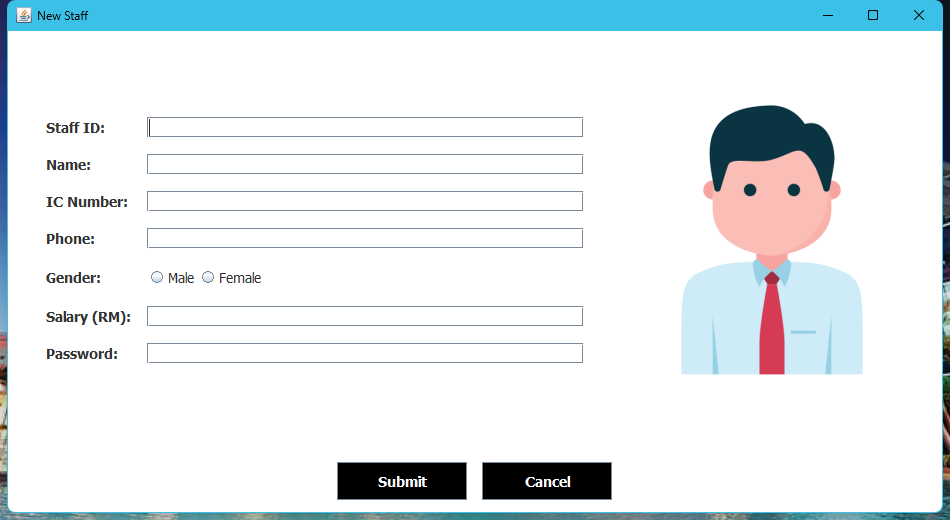</td>
  </tr>
  <tr>
    <td align="center">Admin menu</td>
    <td align="center">New Staff</td>
  </tr>
  <tr>
    <td>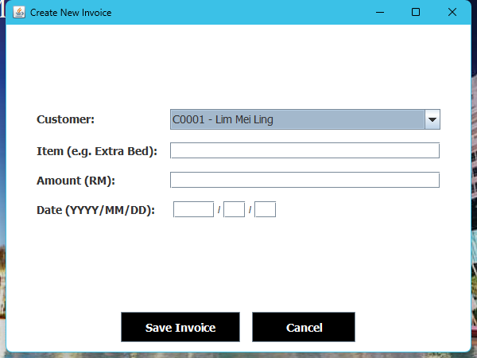</td>
    <td>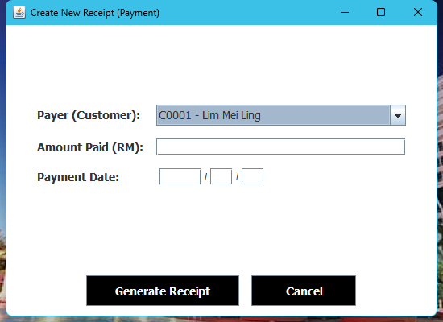</td>
  </tr>
  <tr>
    <td align="center">New Invoice</td>
    <td align="center">New Receipt</td>
  </tr>
</table>

### View

<table>
  <tr>
    <td width="50%">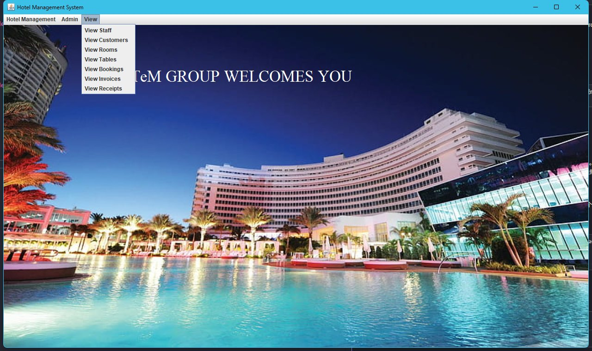</td>
    <td width="50%">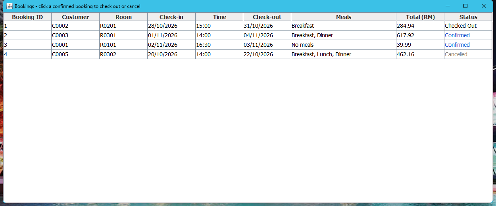</td>
  </tr>
  <tr>
    <td align="center">View menu</td>
    <td align="center">Bookings</td>
  </tr>
  <tr>
    <td>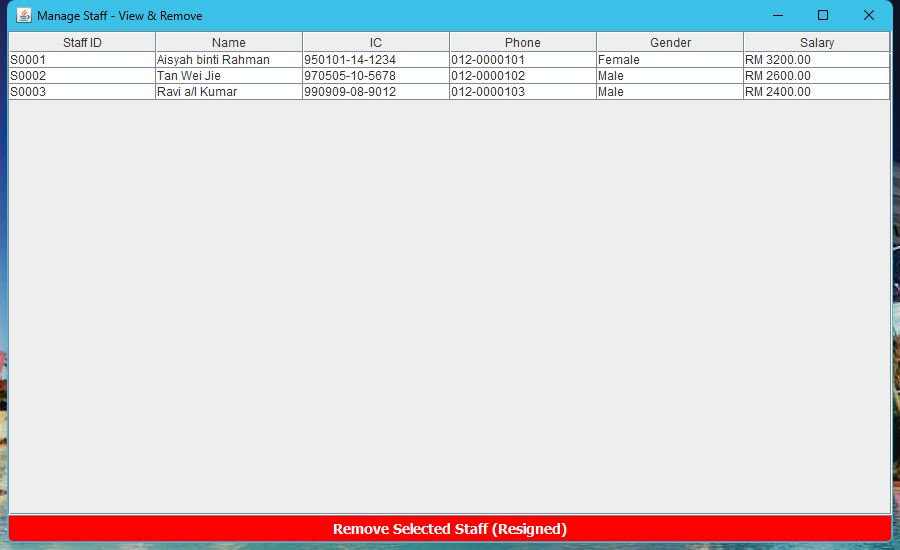</td>
    <td>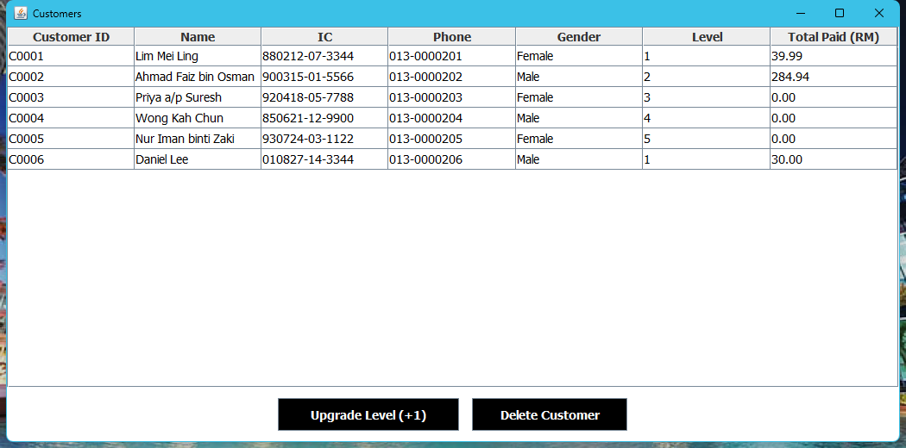</td>
  </tr>
  <tr>
    <td align="center">Staff</td>
    <td align="center">Customers</td>
  </tr>
  <tr>
    <td>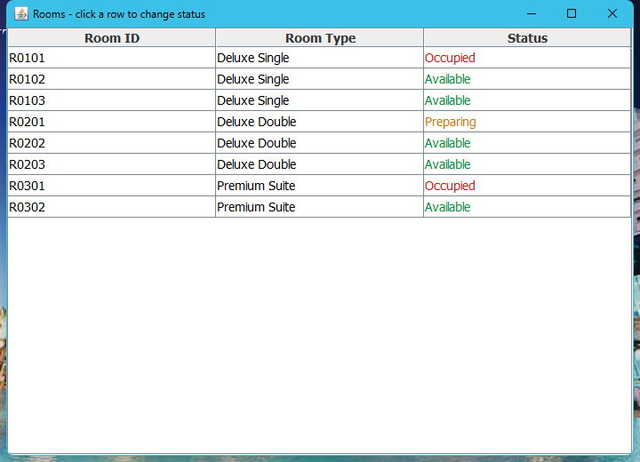</td>
    <td>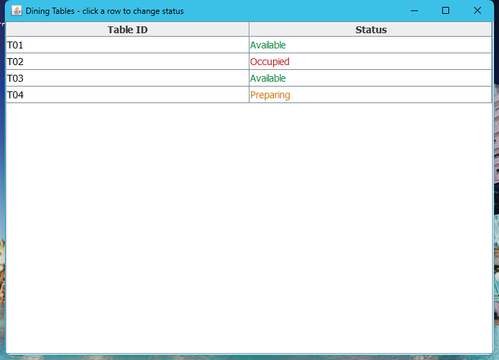</td>
  </tr>
  <tr>
    <td align="center">Rooms</td>
    <td align="center">Dining Tables</td>
  </tr>
  <tr>
    <td>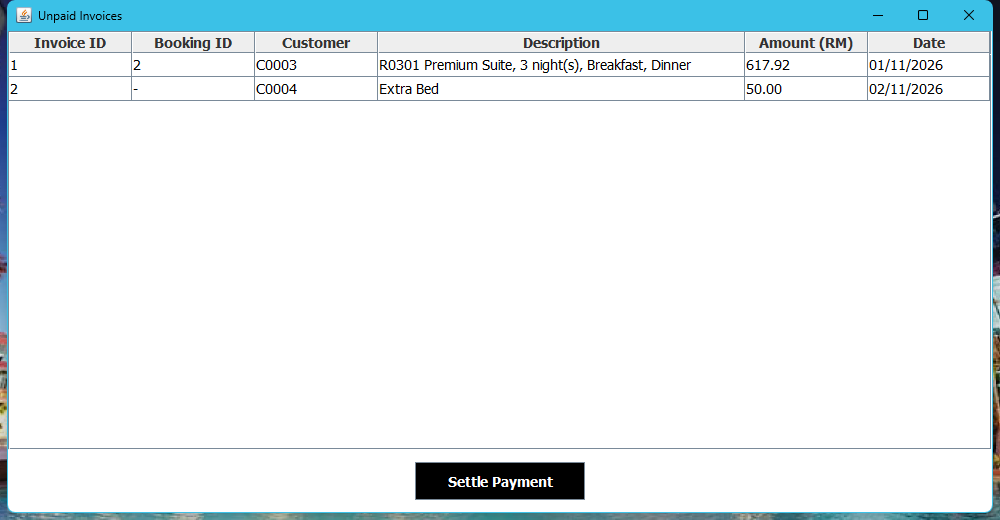</td>
    <td>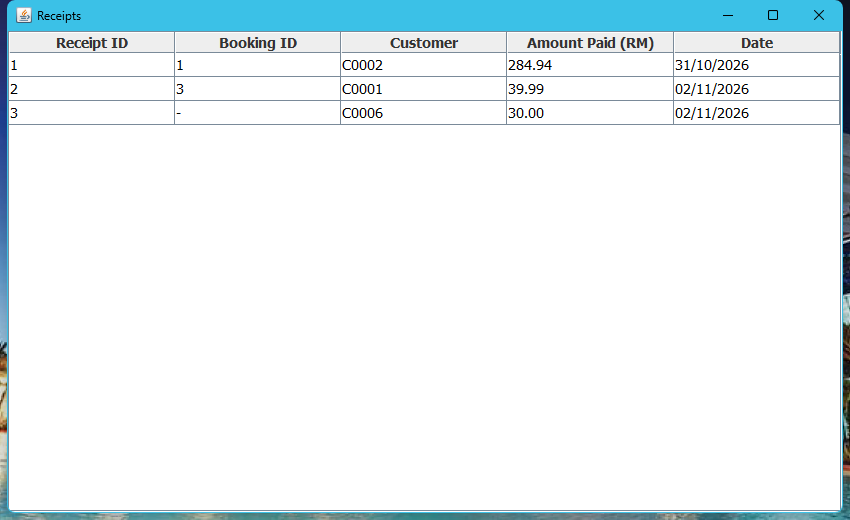</td>
  </tr>
  <tr>
    <td align="center">Unpaid Invoices</td>
    <td align="center">Receipts</td>
  </tr>
</table>

## Pricing

| Room | Per night | | Meal | Per day | | Member level | Discount |
|---|---|---|---|---|---|---|---|
| Deluxe Single | RM 39.99 | | Breakfast | RM 39.99 | | 1 | 0% |
| Deluxe Double | RM 59.99 | | Lunch | RM 59.99 | | 2 / 3 | 5% / 10% |
| Premium Suite | RM 99.99 | | Dinner | RM 88.88 | | 4 / 5 | 15% / 20% |

Total = (room + meals) × nights − member discount, rounded to 2 decimals. For example a level 4 customer in a Deluxe Double for 2 nights with breakfast and dinner pays (59.99 + 39.99 + 88.88) × 2 = RM 377.72, minus 15% = **RM 321.06**.

## Business Rules

- Staff, customer, room and table IDs are unique, up to 5 characters (for example `S0001`, `C0001`, `R0101`).
- Dates must be real dates: 31 April or 29 February in a non leap year are rejected.
- Check-out must be after check-in.
- Only available rooms can be booked.
- A paid booking cannot be cancelled.
- A customer with bookings, invoices or receipts cannot be deleted.
- Money counts as spent only when it is paid.

## Database

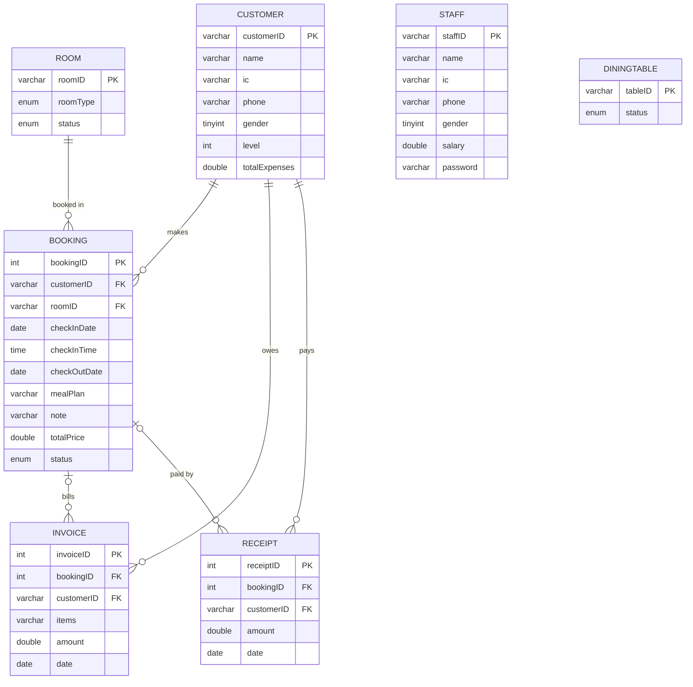

See [hotel_management.sql](database/hotel_management.sql).

## OOP Concepts

| Concept | Where it is used |
|---|---|
| Inheritance | `Customer` and `Staff` extend `Human`. `DeluxeSingle`, `DeluxeDouble` and `PremiumSuite` extend `Room`. The opening screen, login and dashboard extend `JFrame` |
| Abstraction | `Room` is abstract, each room type gives its own name and price |
| Interface | `Room` implements `Payable` and `Bookable`, `DiningTable` implements `Bookable` |
| Polymorphism | `BookingDetail` calls `room.getPriceRate()` without knowing the room type, `Room.of()` builds the right subclass |
| Encapsulation | Model fields are `private` and read through getters |
| Exception handling | Own `DateException`, `TimeException` and `BookingException`, plus `try` / `catch` for `SQLException` |
| Collections | `List<Customer>`, `List<Room>` and the meal list in `BookingDetail` |
| GUI | Swing `JFrame`, `JMenuBar`, `JTable`, `JComboBox` and `GridBagLayout` forms |
| Database | JDBC with `PreparedStatement` for every query, and transactions for bookings and payments |

## Getting Started

1. Install [XAMPP](https://www.apachefriends.org/) and start **MySQL** in the XAMPP Control Panel.
2. Open phpMyAdmin and import `database/hotel_management.sql`.
3. Install JDK 11 or newer, then from the project folder run:

```bash
javac -d out -cp "lib/*" src/hms/*.java
java -cp "out;resources;lib/*" hms.HotelManagementSystem
```

On macOS or Linux use `:` instead of `;` in the classpath.

The app connects to `localhost:3306` as `root` with no password, the XAMPP default. Change it in `src/hms/Database.java` if yours is different. The MariaDB JDBC driver is in `lib/`.

Demo login from the sample data: staff ID `S0001`, password `123456`. All names, IC and phone numbers in the sample data are made up.

## Project Structure

```text
HotelManagementSystem/
├── src/hms/
│   ├── HotelManagementSystem.java   # opening screen, main
│   ├── Login.java
│   ├── Dashboard.java               # menus, forms and lists
│   ├── Hotel.java                   # booking and payment saves
│   ├── Database.java                # jdbc connection
│   ├── Ui.java                      # shared window and form helpers
│   ├── BookingDetail.java           # nights, meals, discount, total
│   ├── Human.java, Customer.java, Staff.java
│   ├── Room.java, DeluxeSingle.java, DeluxeDouble.java, PremiumSuite.java
│   ├── DiningTable.java, Invoice.java, Receipt.java
│   ├── Date.java, Time.java
│   ├── Payable.java, Bookable.java
│   └── DateException.java, TimeException.java, BookingException.java
├── resources/icon/                  # images used by the windows
├── database/hotel_management.sql
├── lib/                             # mariadb jdbc driver
└── docs/                            # showcase page and screenshots
```
